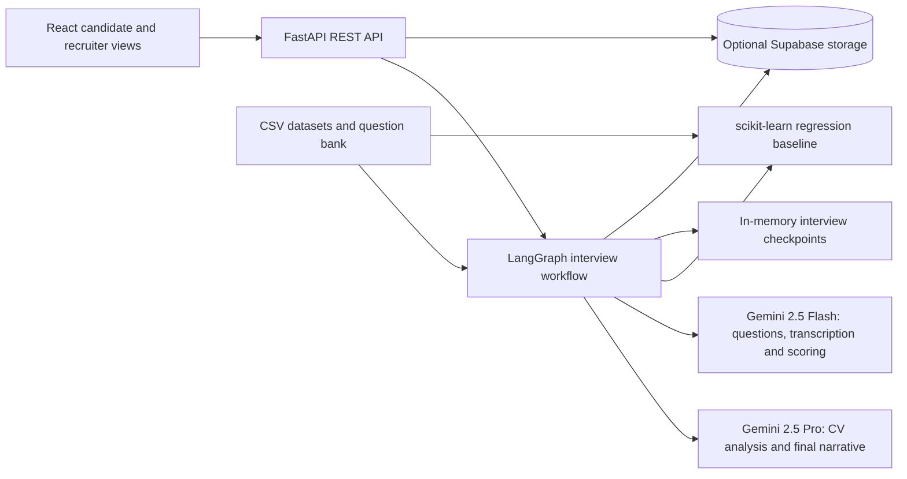

# Mir9ad | مرصاد

**An AI interview platform that connects resume analysis, personalized questions, and recruiter review.**


Mir9ad is a full-stack recruitment prototype for evaluating **Project Manager candidates**. It analyzes an uploaded resume, conducts a tailored interview through the browser, and produces a structured evaluation for a recruiter dashboard. The evaluation combines a regression-based resume baseline with AI analysis of answer content, vocal delivery, and the first answer's video.

The project brings together agent orchestration, multimodal AI, machine learning, REST APIs, and a bilingual React interface in one application.

## Features

- **Resume analysis:** accepts PDF, CSV, and TXT uploads, extracts experience and skills, and identifies supporting evidence and areas to explore.
- **Personalized interviews:** asks two behavioral questions targeting weaker, uncovered evaluation dimensions, followed by a skill test based on the resume.
- **Browser recording:** provides 30 seconds of preparation and up to 60 seconds of recording per answer, with playback before submission.
- **Multimodal evaluation:** transcribes audio, scores answer content and vocal delivery, and analyzes body language from the first recorded answer.
- **Recruiter dashboard:** ranks completed candidates by fit score and displays profiles, strengths, weaknesses, transcripts, and answer score trends. Supabase enables this feature.
- **Arabic and English interface:** includes language switching, browser language detection, and right-to-left layout support for Arabic.
- **Session reconnection:** restores an active interview after a page refresh while the backend process remains running.

## Candidate and recruiter workflow

1. A candidate uploads a resume at `/user`.
2. The backend analyzes the resume against the Project Manager job description and prepares three questions.
3. The candidate records and submits an answer to each question. Audio is submitted for every answer; video is submitted for the first answer.
4. The agent transcribes and evaluates each response, then generates the final assessment. The candidate sees a completion confirmation.
5. With Supabase configured, a recruiter reviews the completed assessment at `/admin`.

## Architecture



The graph follows `load_data → analyze_cv → select_question → ask_question → score_answer`, repeating the question loop before `finalize`. LangGraph's `interrupt()` pauses execution for a candidate response; `Command(resume=...)` continues the same interview, identified by its `interview_id`.

### Engineering highlights

- **Structured model outputs:** Pydantic schemas define CV analysis, question selection, answer scores, delivery observations, and final narratives.
- **Computed evaluation scores:** Python calculates score blends and recommendation thresholds; Gemini supplies the narrative explanation.
- **Resume feature engineering:** a linear regression baseline uses years of experience, skill count, and tool count. It is trained at startup on the supplied CV database, excluding `Unusual/Surprise` records.
- **Model routing:** Gemini Pro handles CV analysis and the final narrative; Gemini Flash handles question generation, transcription, and answer evaluation.
- **Transient error handling:** model calls use retries with exponential backoff for quota and service availability errors.
- **Data exploration:** the [`analysis/`](analysis/) directory includes exploratory analysis, model comparison, formula replication, and saved charts.

## Technology stack

| Layer | Technologies |
| --- | --- |
| Frontend | React 19, Vite, Tailwind CSS, React Router, Lucide icons |
| Localization | i18next, react-i18next, language detection, RTL support |
| Recording | MediaRecorder, browser camera and microphone APIs |
| Backend | Python, FastAPI, Pydantic, pypdf |
| Agent workflow | LangGraph, in-memory checkpointing |
| AI models | Google Gemini 2.5 Pro and Gemini 2.5 Flash |
| Data and ML | pandas, NumPy, scikit-learn, Matplotlib, Seaborn |
| Storage and tracing | Supabase; optional LangSmith tracing |
| Packaging | Multi-stage Docker build; FastAPI serves the built React app |

## Evaluation model

The assessment covers ten dimensions: delivery ownership, business impact, stakeholder management, leadership, communication clarity, technical fluency, evidence credibility, strategic thinking, PM readiness, and authenticity confidence.

The current implementation in [`agent.py`](agent.py) computes scores in three stages:

1. **Answer score:** when all modalities succeed, the blend is **60% content + 25% audio delivery + 15% body language**. Answers with audio and no video use **70% content + 30% delivery**. The backend falls back to available scoring signals when delivery or video analysis fails.
2. **Dimension score:** resume and interview evidence are merged per dimension. The interview weight is `n / (n + 2)`, where `n` is the number of answers for that dimension; dimensions without interview evidence retain their resume score. A weighted sum produces the LLM score on a 0–100 scale.
3. **Overall fit:** **30% LLM score + 70% regression baseline**, clamped to 0–100. A `not_serious` flag zeroes the LLM component, caps overall fit at 30, and forces `Do Not Recommend`.

| Overall fit score | Recommendation |
| --- | --- |
| 75–100 | Recommend |
| 55–<75 | Recommend with Reservations |
| <55 | Do Not Recommend |

These are the prototype's implemented scoring rules. The analysis scripts explore the supplied dataset; they do not establish real-world hiring accuracy.

## Run locally

### Prerequisites

- Python **3.12** and a virtual environment.
- Node.js **22.12 or newer** and npm.
- A Gemini API key with access to the configured models.
- Optional: a Supabase project for persisted candidate records and the recruiter dashboard.

The commands below use Bash on Linux, macOS, or WSL2. On Windows, use WSL2 for the backend or the Docker option: the pinned Python requirements include `uvloop`, which does not support native Windows.

### 1. Clone and install the backend

```bash
git clone https://github.com/SultanAbdulaziz/mir9ad.git
cd mir9ad
python3.12 -m venv .venv
source .venv/bin/activate
python -m pip install -r requirements.txt
cp example.env .env
```

Edit `.env` in the repository root. Set `GEMINI_API_KEY` and leave LangSmith tracing disabled unless you configure it.

| Variable | Purpose |
| --- | --- |
| `GEMINI_API_KEY` | Required for resume analysis and interview evaluation |
| `SUPABASE_URL` | Optional Supabase project URL |
| `SUPABASE_SERVICE_KEY` | Optional backend service role key; enables candidate persistence |
| `LANGSMITH_TRACING` | Set to `true` to enable optional tracing; otherwise use `false` |
| `LANGSMITH_API_KEY` | Required only when tracing is enabled |
| `LANGSMITH_PROJECT` | Optional tracing project name |

The Supabase variables are not in `example.env`; add them if using the dashboard. Keep credentials in the backend `.env`.

### 2. Start the API

Run from the repository root, because the agent loads the `DATA/` files relative to the working directory.

```bash
uvicorn api.main:app --reload --host 0.0.0.0 --port 8000
```

Interactive API documentation: <http://localhost:8000/docs>.

### 3. Start the frontend

In a second terminal, from the repository root:

```bash
npm ci --prefix frontend
VITE_API_URL=http://localhost:8000 npm run dev --prefix frontend
```

For a PowerShell frontend terminal, set the variable with `$env:VITE_API_URL = "http://localhost:8000"`, then run `npm run dev --prefix frontend`.

Open the candidate view at <http://localhost:5173/user> or the recruiter view at <http://localhost:5173/admin>.

`VITE_API_URL` is required when the Vite development server and API use separate ports. When the built frontend is served by FastAPI, leave it unset so requests use the same origin.

### Optional: enable Supabase storage

Set `SUPABASE_URL` and `SUPABASE_SERVICE_KEY` in `.env`, create the tables below in the Supabase SQL editor, and restart the API. This minimal schema matches the current write payloads; the repository does not include database migrations.

<details>
<summary>SQL schema for candidate profiles and evaluations</summary>

```sql
create table if not exists public.cv_profiles (
    candidate_id text primary key,
    role text,
    field text,
    candidate_level text,
    candidate_name text,
    years_experience integer,
    education text,
    certification text,
    core_skills text,
    tools text,
    experience_summary text,
    expected_strengths text,
    expected_weaknesses text,
    expected_fit_score integer,
    expected_recommendation text
);

create table if not exists public.candidates (
    candidate_id text primary key,
    fit_score integer,
    knowledge_and_skills_score integer,
    communication_score integer,
    uncertainty_and_risk_score integer,
    final_recommendation text,
    strengths text,
    weaknesses text,
    interview_qa text
);
```

</details>

Without Supabase, interviews and the final result API still work, but candidate records are not saved and `/admin/candidates` returns `503`.

### Run with Docker

With Docker available and the backend `.env` configured:

```bash
docker build -t mir9ad .
docker run --rm --env-file .env -p 8000:8000 mir9ad
```

Open <http://localhost:8000/user> or <http://localhost:8000/admin>. The container builds React and serves it alongside the API. Leave `VITE_API_URL` unset or empty in frontend environment files when building for this setup.

## API overview

| Method | Endpoint | Purpose |
| --- | --- | --- |
| `GET` | `/healthz` | Report service status and whether the Gemini client is configured |
| `POST` | `/interviews` | Upload a resume and receive the first question |
| `GET` | `/interviews/{id}` | Retrieve the current interview snapshot |
| `POST` | `/interviews/{id}/answer` | Submit recorded media and receive the next question or evaluation |
| `GET` | `/interviews/{id}/result` | Retrieve the completed assessment; returns `409` while incomplete |
| `DELETE` | `/interviews/{id}` | Mark an interview as cancelled |
| `GET` | `/admin/candidates` | Retrieve completed candidates joined with their CV profiles |
| `DELETE` | `/admin/candidates/{id}` | Delete a candidate's evaluation and profile |

Resume uploads use multipart form data with a `resume` file and optional `candidate_name`. The browser limits uploads to **5 MB**. PDFs must contain extractable text; OCR is not implemented. CSV files must contain `Candidate ID`, `Role`, and `Resume Text` columns; the backend processes only the first data row and currently evaluates it for the Project Manager role.

Answer requests contain `audio_b64`, `audio_mime`, and optional `video_b64` and `video_mime`. The backend transcribes the audio; the current public answer schema does not accept a text answer field.

## Repository structure

```text
mir9ad/
├── agent.py                  # Graph, AI calls, scoring, and storage helpers
├── api/
│   ├── main.py               # REST endpoints and built frontend serving
│   └── schemas.py            # API request and response models
├── frontend/
│   └── src/
│       ├── pages/user/       # Resume upload and recorded interview flow
│       ├── pages/admin/      # Recruiter dashboard
│       ├── components/       # Shared UI and animated background
│       └── i18n/             # Arabic and English translations
├── DATA/                     # CV datasets, job descriptions, question bank
├── analysis/                 # EDA, ML notebook, scripts, and charts
├── Dockerfile                # Frontend build and Python runtime
├── requirements.txt          # Pinned Python dependencies
└── example.env               # Backend environment template
```

## Current scope

The runtime evaluates Project Manager candidates, even though the datasets contain other roles. Interview checkpoints use in-process memory and are lost on server restart; Supabase stores candidate profiles and completed evaluations separately. The current admin endpoints have no authentication, and CORS permits all origins. Public deployment requires access control, restricted origins, and durable interview checkpointing.
